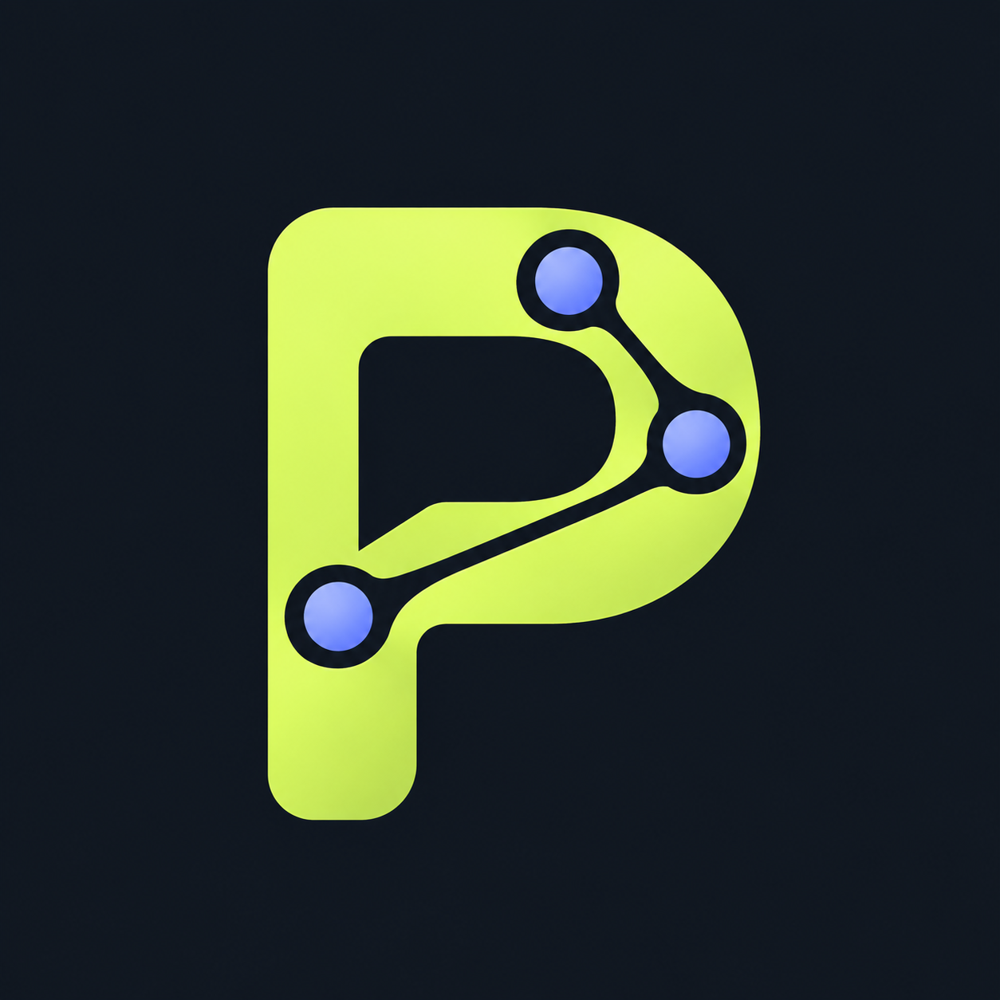

# Property

[Português (Brasil)](README.md) · **English**

<p align="center">
  
</p>

Property is an open project for decentralized communication and voluntary exchange between people, built on Nostr. Its interface runs in a compatible browser on phones, tablets, and computers; access does not depend on app-store approval, publication, or maintenance. It includes an installable PWA, locally controlled identities, encrypted private messaging, and direct connections to relays chosen by each person.

**[Open the app](https://coercaodobem.github.io/property/) · [Contribute](CONTRIBUTING.en.md) · [Roadmap](ROADMAP.md) · [Report an issue](https://github.com/coercaodobem/property/issues/new/choose)**

**Browser access:** open the site on a compatible device and, if you like, add the PWA to your home screen. The app does not need to be distributed through the Play Store or App Store.

**Voluntary exchange:** the marketplace lets people publish and discover offers. Purchases, checkout, and custody are not enabled in this version.

## What we are building

A straightforward way to chat, publish, and discover offers in a decentralized network over Wi-Fi or mobile data. People control their identity and choose which relays carry their events. A password protects a random key created on the device; there is no central login or password recovery. The web host serves static app files; the client connects directly to the selected relays.

PCs can run relays continuously. The browser can forward events between relays only while the PWA is active. Android and iOS may suspend a background PWA, so a continuously running mobile node is not supported by this web app.

The platform goal includes Windows, macOS, Linux/Ubuntu, Android, and iOS. The common interface is the PWA. The portable relay bundles runtimes for Linux x86_64, Windows x64, and macOS Apple Silicon. Other architectures and an always-on mobile relay need separate implementation and validation.

## Current status: MVP under validation

| Area | Available now | Still needed |
|---|---|---|
| Web app | HTTPS PWA; runtime files ship in the same package | Full Android/iOS device validation and accessibility review |
| Identity | Random local key, password-protected vault, persistent session, and encrypted backup | More recovery testing on real devices |
| Messaging | NIP-17 flows and kind 10050 inbox relay lists, with local tests | Broader interoperability testing with real networks |
| PC relay | Geode with bundled runtimes for Linux x86_64, Windows x64, and macOS Apple Silicon | Platform matrix and multi-relay G11-03 gate with 300 probes, three restarts, and nine partition events; see the [test plan status](property/docs/plano-de-testes-central.md) |
| Volunteer bridge | Limited event forwarding between relays while the PWA is active | Continuous mobile operation is not supported by a PWA |
| Marketplace and campaigns | Listings priced in BTC/XMR/XNO and an optional reader for signed campaigns | Checkout and acceptance engine, payments, and refunds |
| Hangout | Public kind 1 feed with reading and posting | Complete integration and validation for Property |

Publishing the app does not mean the full plan is complete. See the [test plan](property/docs/plano-de-testes-central.md) for results and limitations. Payments and automatic node monetization are not enabled in this version.

## Get started

The default development branch is **`modelo-mvp`**. Fork the repository before contributing. See the [contribution guide](CONTRIBUTING.en.md) and the [AI contributor guide](CONTRIBUTING-WITH-AI.md) (Português).

```bash
git clone --branch modelo-mvp https://github.com/coercaodobem/property.git
cd property
```

To serve the web app locally with Python 3:

```bash
python3 -m http.server 8080 --directory property/web
```

Open `http://localhost:8080`. Installing the PWA requires HTTPS, except on localhost. The app shell can open offline after its first load; messaging requires reachable relays.

To start the relay on Linux x86_64 or macOS Apple Silicon:

```bash
./property/relay/start.sh
```

On Windows x64, run this in PowerShell from the checkout root:

```powershell
powershell -NoProfile -File .\property\relay\start.ps1
```

The package includes its Java runtime and verifies SHA-256 before extraction. By default, the relay listens only on `127.0.0.1:7447`. Exposing a relay to the internet requires your own TLS, networking, and storage configuration. See the [relay guide](property/relay/README.md) (Português).

To run the local smoke suite, use Node.js 22 or newer:

```bash
bash property/tests/run-smoke.sh
```

These tests do not make payments or publish messages to public relays. Local integration gates use fixed repetitions, a lab manifest, and network isolation as specified in the [central test plan](property/docs/plano-de-testes-central.md).

## Repository map

| Path | Contents |
|---|---|
| [`property/web/`](property/web/) | PWA and local web dependencies |
| [`property/relay/`](property/relay/) | Portable relay launcher and package |
| [`property/tests/`](property/tests/) | Property product validations |
| [`property/docs/`](property/docs/) | Product identity, decisions, execution notes, and test plan |
| [`geode/`](geode/) | Reused relay code |
| `amethyst/`, `commons/`, `commonsUI/`, `desktopApp/`, `cli/` | Preserved upstream base; their presence does not mean every target is shipped as a Property product |

## Contributing

Bug reports, documentation, tests, accessibility work, and fixes are welcome. No bounty or payment is required to contribute.

1. Check the [roadmap](ROADMAP.md) and [open issues](https://github.com/coercaodobem/property/issues).
2. Read the [contribution guide](CONTRIBUTING.en.md), make a focused change, and describe how you validated it.
3. Open a pull request targeting **`coercaodobem/property:modelo-mvp`**. The maintainer reviews contributions before merging.

For vulnerabilities, use the private channel in [SECURITY.md](SECURITY.md). Never put passwords, private keys, tokens, or private conversations in issues or logs.

AI coding agents should follow [`AGENTS.md`](AGENTS.md), the scoped [`property/AGENTS.md`](property/AGENTS.md), and [`CONTRIBUTING-WITH-AI.md`](CONTRIBUTING-WITH-AI.md) (Português).

## Project context and origins

- [Project identity and principles](property/docs/identidade-do-projeto.md) (Português)
- [Central execution plan](property/docs/plano-central.md) (Português)
- [Test plan and results](property/docs/plano-de-testes-central.md) (Português)
- [Agent communication plan with human-first UX gates](property/docs/plano-agentes-human-first.md) (Português)
- [Agent messaging G0 decision and threat model](property/docs/agent-messaging-g0.md) (Português)
- [Detailed MVP and publishing notes](property/README.md) (Português)

The source snapshot is Amethyst at commit [`948135f`](https://github.com/vitorpamplona/amethyst/tree/948135f7dbbae81d79a0b985282ce673397a7618). Property reuses its codebase and the Geode relay. The PWA uses JavaScript and a locally bundled, version-pinned `nostr-tools` package; it is not a web build of Amethyst's Android interface. The client does not download executable scripts from a CDN at runtime. The complete upstream history remains in the original repository.

Property preserves the MIT license and authorship notices of the reused code. Dependencies have their own licenses, listed in the project inventories. Send Property-specific reports and contributions to this repository.
