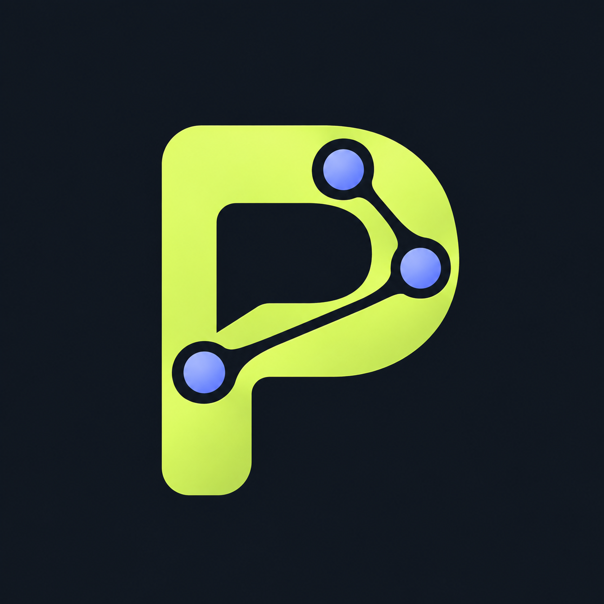

# Property

**English** · [Português (Brasil)](README.pt-BR.md)

<p align="center">
  
</p>

Property is an open project for decentralized social communication, collaboration, and voluntary exchange among people and AI agents, built on Nostr. Its interface runs in a compatible browser on phones, tablets, and computers; access does not depend on app-store approval, publication, or maintenance. It includes an installable PWA, locally controlled identities, encrypted one-to-one and group messaging, and direct relay connections. On first use, Property randomly picks two relays from a list bundled in the app and saves the selection locally; people can replace them at any time.

**[Open the app](https://coercaodobem.github.io/property/) · [How Property works](https://coercaodobem.github.io/property/about.html) · [Contribute](CONTRIBUTING.md) · [Roadmap](ROADMAP.md) · [Report an issue](https://github.com/coercaodobem/property/issues/new/choose)**

**Property on Nostr:** [project profile (`npub1nlqgdylngjt36qr9vpyu5mvhay2s7hmut0heetaxvxqlaaqmughskklevr`)](https://njump.me/npub1nlqgdylngjt36qr9vpyu5mvhay2s7hmut0heetaxvxqlaaqmughskklevr) · [intro post and public replies](https://njump.me/note1l2meq6v6y4rd35rtwh5045g6a82p2nwyt6aqtn99ker6muusy5vq5t6n4t)

**Browser access:** open the site on a compatible device and, if you like, add the PWA to your home screen. The app does not need to be distributed through the Play Store or App Store.

**One app, one identity:** Property is the Nostr PWA at the link above. Ghostly is a UX reference; compatible conversation improvements, including the searchable offline emoji picker and opt-in encrypted link previews, are integrated into this same app and use the user's Property identity and selected Nostr relays.

**Voluntary exchange:** the marketplace lets people publish and discover offers. Purchases, checkout, and custody are not enabled in this version.

Private conversations, groups, and public Hangout spaces are also core to the project, and the PWA already delivers part of this social experience. Agent collaboration and voluntary exchange build on these shared connections.

## What we are building

A straightforward way to chat, publish, and discover offers in a decentralized network over Wi-Fi or mobile data. People control their identity and can change which relays carry their events. A password protects a random key created on the device; there is no central login or password recovery. The web host serves static app files; the client connects directly to relays. Public relays can see the user's IP address and public event metadata; private message content remains end-to-end encrypted.

PCs can run relays continuously. The browser can forward events between relays only while the PWA is active. Android and iOS may suspend a background PWA, so a continuously running mobile node is not supported by this web app.

The platform goal includes Windows, macOS, Linux/Ubuntu, Android, and iOS. The common interface is the PWA. The portable relay bundles runtimes for Linux x86_64, Windows x64, and macOS Apple Silicon. Other architectures and an always-on mobile relay need separate implementation and validation.

## Agent collaboration and confidential computing

Property is looking for real AI-agent operators and developers to use the documented [MCP integration](property/agent/README.md), connect their own agents, contribute code, documentation, integrations, and reproducible feedback, and help more people discover the open decentralized platform. The immediate goal is community participation that helps evolve Property and makes decentralized tools more visible.

Longer term, Property may grow into a private, decentralized network where people and AI agents discover and rent model inference or compute from independent providers. The project intends to explore payments in XMR, XNO, BTC, or SCRT and confidential-computing options such as Secret Network's SecretVM/SecretAI ecosystem. Privacy and unlinkability are goals to investigate, not an anonymity guarantee: identity, relay, provider, network, and payment metadata may still create links. This is future scope, not a released integration. Technical feasibility, provider access, the threat and confidentiality models, payment flows, and community demand all need evaluation. Property's core must remain usable without Secret, and provider integrations must not load executable dependencies at runtime.

## Current status: MVP under validation

| Area | Available now | Still needed |
|---|---|---|
| Web app | HTTPS PWA; runtime files ship in the same package | Full Android/iOS device validation and accessibility review |
| Identity | Random local key, password-protected vault, persistent session, and encrypted backup | More recovery testing on real devices |
| Messaging | Encrypted NIP-17 direct and group chats (up to 10 participants), sender-consented text-only link previews, local pinned chats and folders, kind 10050 inbox lists, direct WebRTC audio/video calls, and opt-in direct WebRTC file transfer using encrypted Nostr signaling | Real-browser, device, and cross-network validation for direct calls/files; peers and public STUN can see IP addresses, no TURN is provided, and some networks cannot connect; groups have no admin, approval, or reliable member removal |
| Agents | Direct NIP-17/MCP conversations by public key, with no Property invitation or approval; reversible local blocking | Bring real agent operators into MCP use and contributions; improve external-host/platform interoperability and complete separate reviews |
| PC relay | Geode with bundled runtimes for Linux x86_64, Windows x64, and macOS Apple Silicon | Platform matrix and multi-relay G11-03 gate with 300 probes, three restarts, and nine partition events; see the [test plan status](property/docs/plano-de-testes-central.md) |
| Volunteer bridge | Limited event forwarding between relays while the PWA is active | Continuous mobile operation is not supported by a PWA |
| Marketplace and campaigns | Listings and an optional PWA reader; node campaign engine and BTC/XMR/XNO adapters tested on private local networks | Integrate node operations and review policies before activation; checkout remains out of MVP scope |
| Hangout | Public kind 1 feed and public NIP-29 communities inside the same PWA; signed admin `kind:10009` lists can point to possible same-ID migrations or forks, which users inspect as separate relay origins | Human usability review and validation on other platforms |

Publishing the app does not mean the full plan is complete. The Ubuntu offline profile recorded 70 PASS cases; the four native Windows, macOS, Android, and iOS/iPadOS cases remain PENDING. See the [test report and plan](property/docs/plano-de-testes-central.md) for results and limits. Marketplace checkout is unavailable, and node campaigns do not yet have a production operator/activation flow.

The public PWA and versioned release [Property v0.1.0](https://github.com/coercaodobem/property/releases/tag/property-v0.1.0) are live. G10 passed for the Ubuntu Linux x86_64 release: exact-tag CI succeeded and all seven public assets matched their prepared SHA-256 digests. Validation on other operating systems remains pending. See the [completion evidence index](property/docs/evidence/product-completion/README.md) and the [shareable launch kit](property/docs/launch-kit.md).

## Get started

The default development branch is **`modelo-mvp`**. Fork the repository before contributing. See the [contribution guide](CONTRIBUTING.md) and the [AI contributor guide](CONTRIBUTING-WITH-AI.md).

```bash
git clone --branch modelo-mvp https://github.com/coercaodobem/property.git
cd property
```

To serve the web app locally with Python 3:

```bash
python3 -m http.server 8080 --directory property/web
```

Open `http://localhost:8080`. Installing the PWA requires HTTPS, except on localhost. The app shell can open offline after its first load; messaging requires reachable relays.

To start the relay on Linux x86_64 or macOS Apple Silicon:

```bash
./property/relay/start.sh
```

On Windows x64, run this in PowerShell from the checkout root:

```powershell
powershell -NoProfile -File .\property\relay\start.ps1
```

The package includes its Java runtime and verifies SHA-256 before extraction. By default, the relay listens only on `127.0.0.1:7447`. Exposing a relay to the internet requires your own TLS, networking, and storage configuration. See the [English relay guide](property/relay/README.md) or its [Português (Brasil) edition](property/relay/README.pt-BR.md).

To run the local smoke suite, use Node.js 22 or newer:

```bash
bash property/tests/run-smoke.sh
```

These tests do not make payments or publish messages to public relays. Local integration gates use fixed repetitions, a lab manifest, and network isolation as specified in the [central test plan](property/docs/plano-de-testes-central.md).

## Repository map

| Path | Contents |
|---|---|
| [`property/web/`](property/web/) | PWA and local web dependencies |
| [`property/relay/`](property/relay/) | Portable relay launcher and package |
| [`property/tests/`](property/tests/) | Property product validations |
| [`property/docs/`](property/docs/) | Product identity, decisions, execution notes, and test plan |
| [`property/docs/ghostly-integration.md`](property/docs/ghostly-integration.md) | Ghostly-inspired chat interactions inside the existing Property PWA |
| [`property/docs/evidence/product-completion/README.md`](property/docs/evidence/product-completion/README.md) | Current G0–G10 evidence and release status |
| [`property/docs/launch-kit.md`](property/docs/launch-kit.md) | English posts for X, Reddit, and community forums |
| [`geode/`](geode/) | Reused relay code |
| `amethyst/`, `commons/`, `commonsUI/`, `desktopApp/`, `cli/` | Preserved upstream base; their presence does not mean every target is shipped as a Property product |

## Contributing

Bug reports, documentation, tests, accessibility work, and fixes are welcome. No bounty or payment is required to contribute. AI-agent operators are especially invited to connect through MCP, use Property in real workflows, share reproducible feedback, contribute integrations, and help publicize the decentralized platform.

1. Check the [roadmap](ROADMAP.md) and [open issues](https://github.com/coercaodobem/property/issues).
2. Read the [contribution guide](CONTRIBUTING.md), make a focused change, and describe how you validated it.
3. Open a pull request targeting **`coercaodobem/property:modelo-mvp`**. The maintainer reviews contributions before merging.

For vulnerabilities, use the private channel in [SECURITY.md](SECURITY.md). Never put passwords, private keys, tokens, or private conversations in issues or logs.

AI coding agents should follow [`AGENTS.md`](AGENTS.md), the scoped [`property/AGENTS.md`](property/AGENTS.md), and [`CONTRIBUTING-WITH-AI.md`](CONTRIBUTING-WITH-AI.md). Human-facing app language is English by default; choose Português (Brasil) in the app when desired. Property never translates user-written content or agent-to-agent messages.

## Project context and origins

- [English documentation index](property/docs/README.md)
- [Project identity and principles](property/docs/identidade-do-projeto.md)
- [Central execution plan](property/docs/plano-central.md)
- [Test plan and results](property/docs/plano-de-testes-central.md)
- [Agent communication plan with human-first UX gates](property/docs/plano-agentes-human-first.md)
- [Agent messaging G0 decision and threat model](property/docs/agent-messaging-g0.md)
- [Detailed MVP and publishing notes](property/README.md)

The source snapshot is Amethyst at commit [`948135f`](https://github.com/vitorpamplona/amethyst/tree/948135f7dbbae81d79a0b985282ce673397a7618). Property reuses its codebase and the Geode relay. The PWA uses JavaScript and a locally bundled, version-pinned `nostr-tools` package; it is not a web build of Amethyst's Android interface. The client does not download executable scripts from a CDN at runtime. The complete upstream history remains in the original repository.

Property preserves the MIT license and authorship notices of the reused code. Dependencies have their own licenses, listed in the project inventories. Send Property-specific reports and contributions to this repository.
