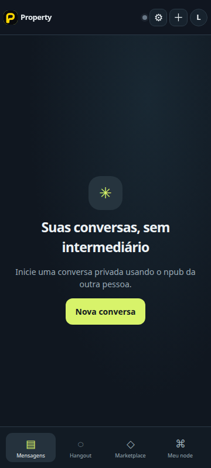
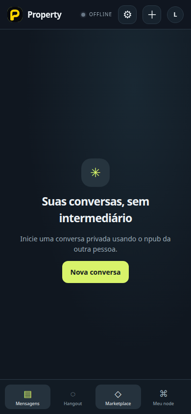
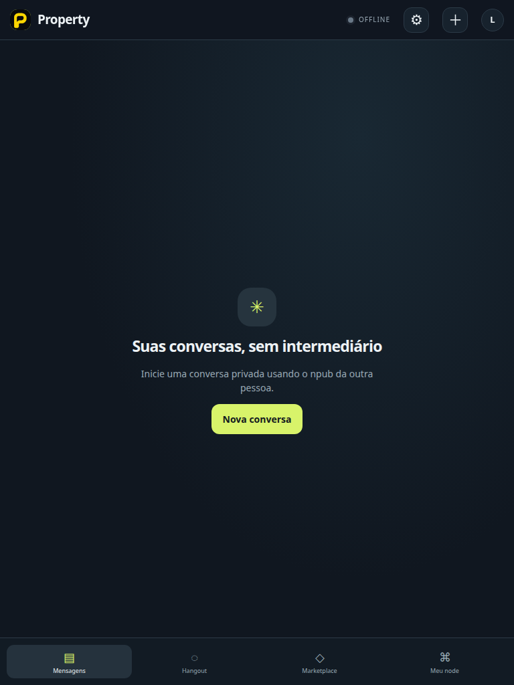
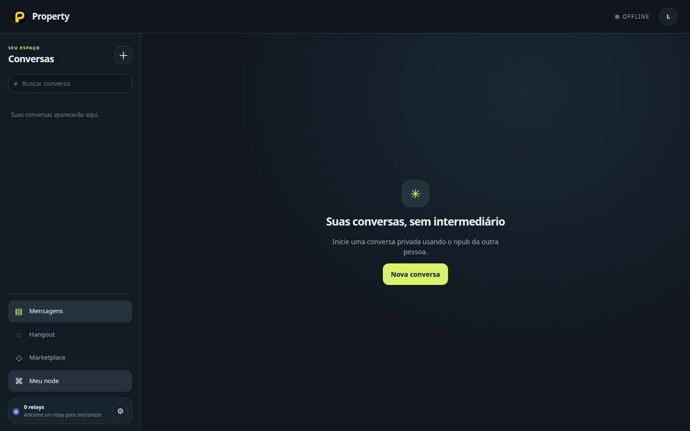
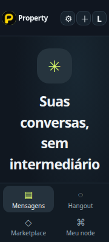
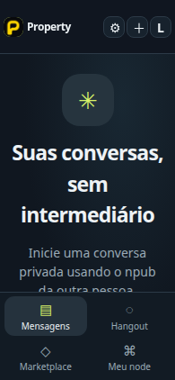
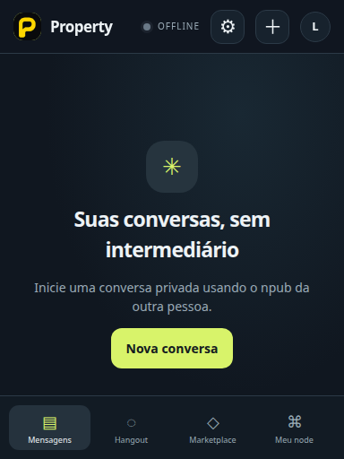
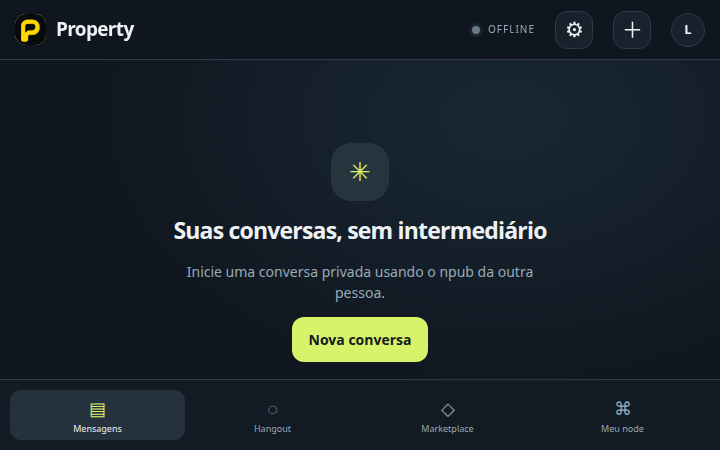

# Revisão visual G10-05

O teste automatizado capturou as oito imagens abaixo. `G10-05` passou nas asserções de viewport; a revisão visual por uma pessoa continua **PENDING**. As capturas não representam aprovação humana nem avaliação de participantes.

## Viewports fixos

### 360 × 800

### 390 × 844

### 768 × 1024

### 1440 × 900

## Largura efetiva com zoom de 200%

### Origem 360 × 800

### Origem 390 × 844

### Origem 768 × 1024

### Origem 1440 × 900

Relatório automatizado: [`g10-viewport-report.json`](g10-viewport-report.json).
