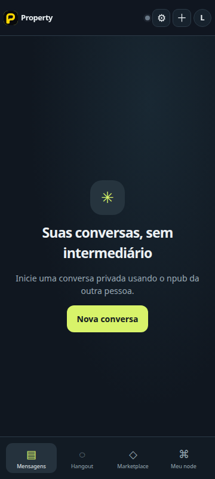
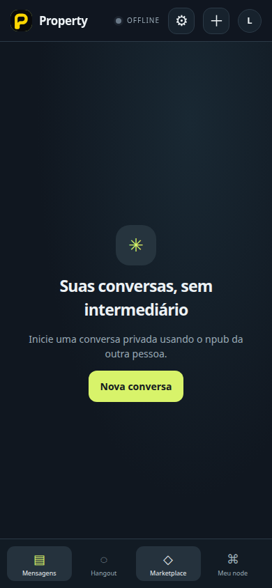
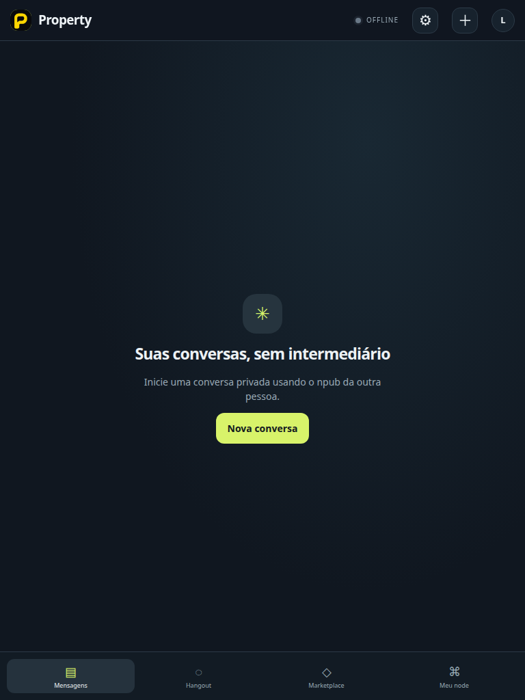
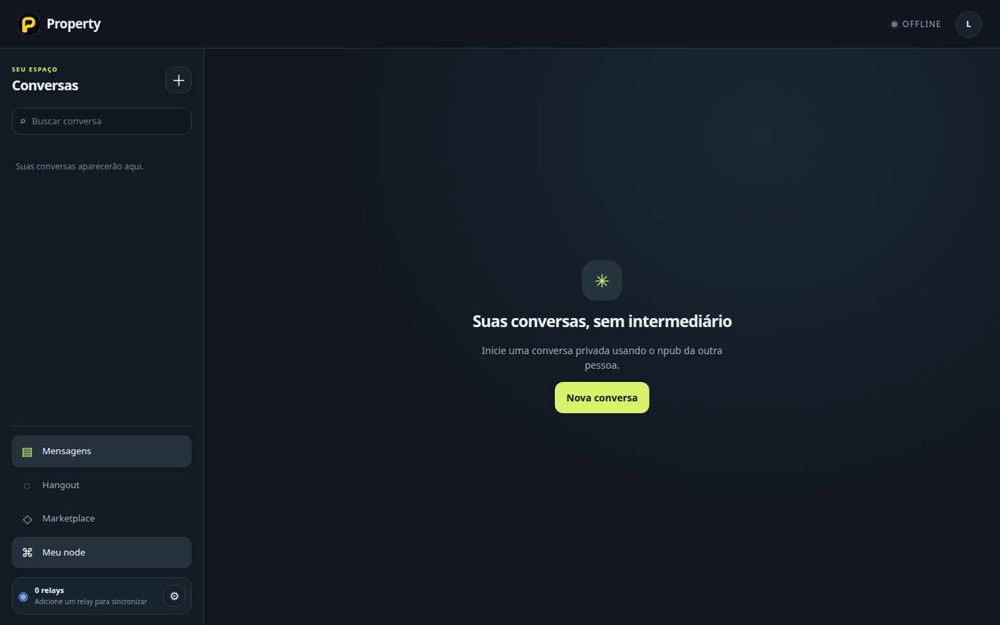
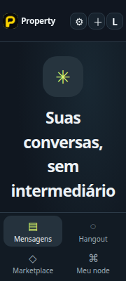
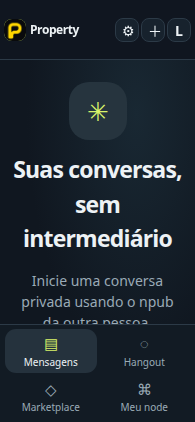
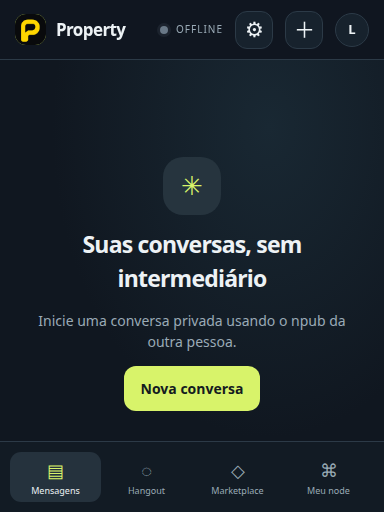
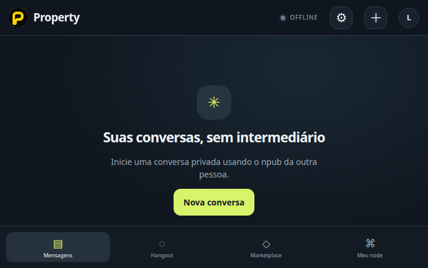

# Revisão humana de UX — G10-05

**Estado:** pendente. Esta página organiza as capturas para revisão; não registra nem simula uma aprovação humana.

As capturas foram geradas em navegador Chromium nos viewports declarados abaixo. Os tamanhos móveis são emulados e não comprovam instalação ou uso em aparelhos Android/iOS. O relatório automatizado associado é [`g10-viewport-report.json`](g10-viewport-report.json).

## Itens para revisar

- Controles essenciais aparecem inteiros e podem ser encontrados sem rolagem horizontal involuntária.
- Texto, avisos e hierarquia visual são compreensíveis em português.
- No zoom de 200%, informações e ações essenciais continuam visíveis.
- Qualquer problema visível pode ser descrito por viewport e captura.

A navegação por teclado, foco visível e nomes acessíveis também fazem parte do caso automatizado; uma captura estática não os certifica por si só.

## Viewports

### 360 × 800

### 390 × 844

### 768 × 1024

### 1440 × 900

## Zoom de 200%

## Registro da revisão

- Resultado humano: **PENDING**
- Revisor:
- Observações ou correções necessárias:
